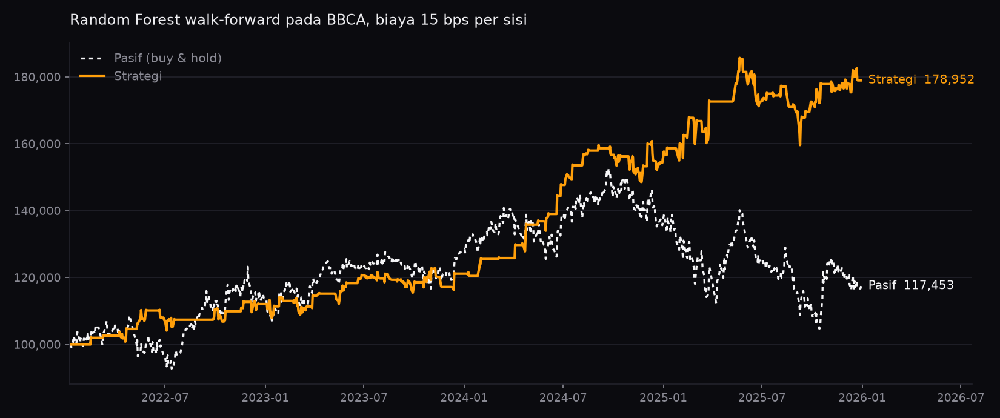
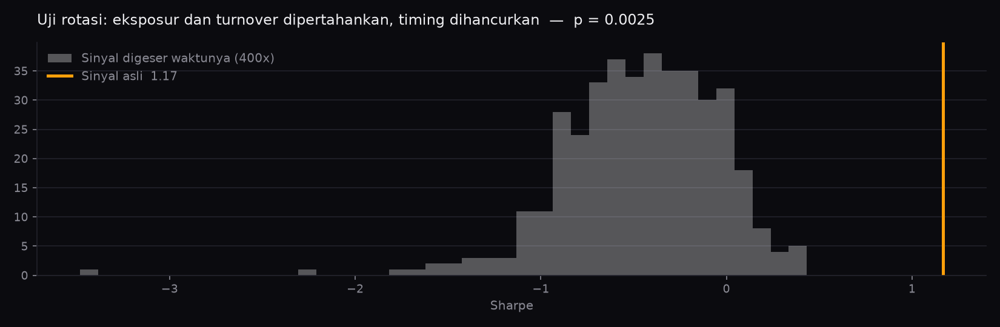

# StockLab

Lab backtesting model machine learning untuk data saham — walk-forward, biaya
transaksi, dan serangkaian pemeriksaan yang tugasnya **mementahkan** hasil
backtest, bukan mempercantiknya.



Analoginya SPSS: user membawa model dan hipotesisnya, aplikasi mengurus
eksperimen, validasi, dan pelaporannya — tanpa user perlu menulis kode.

---

## Kenapa proyek ini ada

Hampir semua proyek *stock prediction* di GitHub menampilkan equity curve yang
menanjak mulus dan mengalahkan pasar telak. Hampir semuanya salah, dan salahnya
selalu dari sumber yang sama: model dilatih pada seluruh rentang lalu diminta
memprediksi rentang yang sama, indikator diam-diam melihat ke depan, biaya
transaksi tidak dihitung, dan konfigurasi terbaik dari ratusan percobaan
dilaporkan seolah-olah satu-satunya yang pernah dicoba.

Tidak satu pun dari kesalahan itu melempar error. Semuanya menghasilkan angka
yang terlihat meyakinkan.

StockLab dibangun dengan asumsi terbalik: setiap hasil yang bagus dianggap
salah sampai berhasil bertahan dari usaha untuk mementahkannya.

---

## Menjalankan

```bash
pip install -e ".[app]"
python -m streamlit run stocklab_app.py
```

Buka `http://localhost:8501`. Server hanya mendengarkan di localhost.

Chatbotnya memakai [Ollama](https://ollama.com) lokal — tanpa biaya API dan data
tidak meninggalkan mesin Anda:

```bash
ollama pull llama3.2
```

Kalau Ollama tidak terpasang, panel asisten tetap berfungsi dengan ringkasan
yang disusun Python. Angkanya sama persis; yang hilang cuma percakapannya.

Paket intinya bisa dipakai dari notebook tanpa menyentuh Streamlit sama sekali:

```python
from stocklab.data import load_ohlcv
from stocklab.features import FeatureConfig, build_features
from stocklab.models import build_model, direction_target
from stocklab.backtest import walk_forward_signals, run_backtest

ohlcv = load_ohlcv("BBCA.JK", "2021-01-01", "2025-12-31")
X = build_features(ohlcv, [FeatureConfig("rsi", {"window": 14}),
                           FeatureConfig("macd")])
y = direction_target(ohlcv["close"], horizon=1)

wf = walk_forward_signals(lambda: build_model("random_forest"), X, y,
                          train_size=252, test_size=21, embargo=1)
bt = run_backtest(ohlcv["close"], wf.signals, cost_bps=10, slippage_bps=5)
print(bt.summary())
```

---

## Metodologi

Bagian ini yang paling penting dibaca. Semua keputusan di bawah membuat hasilnya
**lebih buruk** daripada kalau diabaikan — dan itu memang maksudnya.

### Walk-forward, bukan latih-sekali

Data dibagi jadi blok berurutan. Untuk tiap blok, model dilatih ulang **dari
nol** hanya memakai bar sebelum blok itu. Tidak ada satu pun prediksi yang
dihasilkan model yang pernah melihat bar yang sedang diprediksinya.

### Embargo

Memisahkan latih dan uji saja tidak cukup. Label `y[t]` menjawab apa yang
terjadi di bar `t + horizon`, jadi baris latih paling akhir sudah memuat
informasi dari bar yang secara kronologis berada **di dalam** periode uji.
Jaraknya kecil, tidak memicu error apa pun, dan cukup untuk membuat hasil
terlihat lebih baik daripada yang sebenarnya. Embargo membuang `horizon` baris
terakhir dari tiap jendela latih, dan nilainya diturunkan dari horizon — bukan
parameter terpisah — supaya kombinasi yang salah tidak bisa dibentuk.

### Eksekusi di t+1

Sinyal dari bar `t` menentukan posisi yang dipegang selama bar `t+1`.
Parameter ini muncul eksplisit di signature `run_backtest`, bukan tersembunyi
sebagai konstanta, karena ini pertanyaan pertama siapa pun yang membaca hasil
backtest.

### Indikator yang kausal, dan dibuktikan begitu

Setiap indikator dihitung pada seluruh data, lalu dihitung ulang pada potongan
awalnya saja. Bagian yang tumpang tindih harus sama persis. Kalau ada informasi
masa depan merembes — lewat `center=True`, backfill, atau normalisasi seluruh
sampel — nilai lama akan bergeser dan test gagal.

Pengujian ini berjalan otomatis untuk **setiap** indikator di registry, dan ada
satu indikator yang sengaja dibuat bocor untuk membuktikan pagarnya menangkap.
Pagar yang tidak pernah diuji tidak bisa dipercaya.

### Jendela yang adil

Selama warmup indikator dan jendela latih pertama, model belum boleh
berpendapat sementara buy & hold sudah terisi penuh. Memasukkan periode itu
bukan membandingkan dua keputusan, melainkan membandingkan satu keputusan
dengan ketiadaan keputusan. Backtest hanya menghitung jendela yang bisa
diperdagangkan, dan kedua garis berangkat dari modal yang sama di tanggal yang
sama.

Pada BBCA, koreksi ini memindahkan Sharpe benchmark dari **+0,16 ke −0,12** —
seluruh selisihnya berasal dari kenaikan yang terjadi sebelum model boleh
bertrading sama sekali.

### Biaya dan turnover

Biaya dan slippage dibebankan pada turnover, dalam basis point per sisi
transaksi. Satu round-trip penuh bernilai turnover 2,0.

---

## Pemeriksaan validasi

Empat pertanyaan berbeda. Sebuah strategi bisa lolos tiga lalu gugur di yang
keempat.

### Uji rotasi



Strategi bisa terlihat hebat hanya karena **bentuk posisinya**. Model yang
berdiam di kas dua pertiga waktu otomatis punya volatilitas rendah, dan
Sharpe-nya naik tanpa satu pun prediksi yang benar. Membandingkannya dengan buy
& hold tidak menjawab itu, karena buy & hold selalu terisi penuh.

Uji ini membandingkan strategi dengan dirinya sendiri yang diacak waktunya.
Deret sinyal digeser melingkar: jumlah bar terisi, panjang tiap posisi, dan
total turnover tetap sama, tapi keselarasan dengan pergerakan harga hancur. Yang
tersisa cuma bentuk posisi tanpa timing.

Kalau Sharpe asli tenggelam di dalam sebaran itu, keunggulannya berasal dari
bentuk, bukan dari prediksi.

p-value memakai koreksi `(1+k)/(1+n)`, supaya hasil yang tidak pernah terlampaui
tidak dilaporkan sebagai `p = 0` — 400 geseran tidak membuktikan peluangnya nol.
Kalau seluruh geseran yang mungkin muat, uji menjadi eksak dan seed berhenti
berpengaruh, sehingga hasilnya tidak bisa diulang-ulang sampai keluar angka yang
menyenangkan.

### Sensitivitas biaya

Strategi ber-turnover tinggi hidup atau mati di asumsi biaya, dan asumsi itu
biasanya diketik sekali lalu dilupakan. Yang dilaporkan: pada biaya berapa
keunggulan itu habis.

### Stabilitas parameter

Model dilatih ulang untuk tiap kombinasi. Puncak sempit yang runtuh begitu satu
slider digeser adalah tanda model menghafal, bukan menemukan.

### Stabilitas periode

Alur yang sama dijalankan pada beberapa rentang waktu. Ini yang paling sering
mementahkan strategi yang lolos semua pemeriksaan lain — dan yang paling jarang
diperiksa, karena hasilnya paling sering mengecewakan.

### Deflated Sharpe

Tiap kali slider digeser lalu dijalankan ulang, itu satu percobaan tambahan
dalam pencarian. Geser cukup sering, dan konfigurasi terbaik akan terlihat
meyakinkan tanpa alasan apa pun.

StockLab menghitung berapa konfigurasi berbeda yang sudah dicoba dalam satu
sesi, lalu menampilkan deflated Sharpe di sebelah Sharpe biasa. Menjalankan
ulang pengaturan yang sama tidak dihitung sebagai pencarian baru.

Koreksinya hanya sebaik pembukuan yang menopangnya: memilih model ini setelah
mencoba model lain, memilih indikator ini, memilih periode ini — tidak ada yang
terhitung.

**Laporan gabungannya sengaja tidak memberi vonis lulus atau gagal.** Ambang apa
pun yang dipilih akan sewenang-wenang, dan label "LULUS" pada sebuah strategi
jauh lebih berbahaya daripada tidak ada label sama sekali. Yang diberikan daftar
kekhawatiran berikut angkanya.

---

## Hasil pada BBCA

Random Forest (100 pohon), 5 indikator, walk-forward pada 2022-01-07 sampai
2025-12-30 — 954 bar, 46 kali latih ulang — biaya 15 bps per sisi:

| | Strategi | Pasif |
|---|---|---|
| Ekuitas akhir | 178.952 | 117.453 |
| Sharpe | 1,17 | 0,30 |
| Drawdown terdalam | −14,0% | −31,4% |
| Eksposur | 34,2% | 100% |
| Turnover | 57×/tahun | — |

Hasil pemeriksaan:

| Pemeriksaan | Hasil |
|---|---|
| Uji rotasi | Sharpe asli **1,17** vs maksimum acak **0,43** dari 400 geseran — **p = 0,0025** |
| Stabilitas parameter | 9 kombinasi, **semuanya** unggul; terburuk 0,80, median 1,31 |
| Stabilitas periode | 3 jendela tiga-tahunan; unggul nominal di 2, unggul Sharpe di 3 |
| Titik impas biaya | **35 bps** per sisi |
| Deflated Sharpe | **0,95** setelah memperhitungkan 9 konfigurasi |

Uji rotasi menutup penjelasan yang paling mungkin: bahwa keunggulan Sharpe cuma
efek berdiam di kas dua pertiga waktu. Kalau begitu, sinyal acak dengan pola
posisi identik akan sama bagusnya — ternyata tidak, dan jaraknya jauh. Timing
model memang membawa informasi.

**Yang tetap perlu diwaspadai:** turnover 57×/tahun membuat hasil ini sangat
bergantung pada asumsi biaya. Titik impasnya 35 bps per sisi, sementara biaya
ritel BEI berada di kisaran yang perlu Anda cek sendiri ke broker Anda. Marginnya
ada, tapi tidak lebar.

Dan seluruh angka di atas berasal dari **satu saham**. Edge yang terlihat bisa
jadi sifat BBCA, bukan sifat metodenya — validasi lintas saham belum dikerjakan,
dan sampai itu ada, ini satu titik data, bukan bukti.

---

## Arsitektur

```
stocklab/
├── data/          loader (yfinance + cache parquet), normalisasi
├── features/      indikator kausal + registry yang bisa dirender UI
├── models/        kontrak adapter, model zoo, pembentukan label
├── backtest/      engine, metrik, walk-forward
├── validation/    rotasi, biaya, stabilitas, laporan gabungan
├── llm/           klien Ollama + ringkasan cadangan tanpa LLM
└── ui/            Streamlit — lapisan tipis, tanpa perhitungan
```

Dua invariant yang memegang seluruh struktur ini:

**Engine backtest tidak pernah melihat objek model.** Dia hanya menerima deret
bobot target. Itu yang membuatnya bisa diuji tanpa melatih apa pun, dan yang
membuat penambahan jenis model baru tidak menyentuh engine sama sekali.

**UI tidak menghitung apa pun.** `stocklab/` harus bisa dipakai penuh dari
notebook. Panel parameter dirender dari `ParamSpec`, jadi tidak ada satu pun
nama parameter atau nama indikator yang ditulis di berkas antarmuka — menambah
indikator ke registry langsung memunculkannya di panel.

### Kontrak model

```python
class ModelAdapter(Protocol):
    def describe(self) -> ModelSpec: ...
    def predict_signal(self, X: pd.DataFrame) -> pd.Series: ...
    def fit(self, X, y) -> None: ...   # pretrained boleh raise
```

Tiga metode, dan tidak satu pun menyebut scikit-learn, torch, atau format file.

Untuk artifact yang di-upload, deteksi parameter berjalan lewat introspeksi
biasa: `feature_names_in_` menyebutkan fitur yang dibutuhkan model beserta
urutannya, `get_params()` mengisi panel parameter. Kolom otomatis diurutkan
ulang sesuai urutan saat model dilatih — urutan yang tertukar diam-diam adalah
bug paling sunyi di seluruh alur ini.

### Rentang parameter tidak pernah ditebak

Kalau batas sebuah parameter tidak diketahui, UI merender kotak angka, bukan
slider. Slider dengan rentang karangan terlihat berwibawa padahal isinya asal,
dan user tidak punya cara membedakannya.

---

## Threat model

Memuat artifact model berarti menjalankan kode dari berkas asing.
`pickle.load()` dan `joblib.load()` mengeksekusi kode arbitrer saat
deserialisasi — ini bukan risiko sampingan, ini permukaan serang utama dari
fitur upload.

Karena itu **jalur upload sengaja dinonaktifkan** sampai hal berikut selesai:

- Allowlist format, mengutamakan ONNX dan safetensors di atas pickle
- Pemuatan di subprocess terisolasi dengan batas waktu dan memori
- Batas ukuran berkas

Sampai itu ada, jalankan StockLab hanya dengan model dari zoo bawaan, atau
dengan artifact yang Anda buat sendiri di mesin yang sama.

Server Streamlit diikat ke `localhost`. Default Streamlit mendengarkan di
`0.0.0.0`, yang membuat lab ini terbuka bagi siapa pun di jaringan yang sama.

**Ini perkakas riset, bukan nasihat investasi.** Chatbotnya diinstruksikan untuk
tidak memberi rekomendasi beli/jual atau proyeksi harga, dan tidak pernah
menghitung sendiri — Python yang menghitung seluruh metrik, LLM hanya
menjelaskannya.

---

## Batasan yang diketahui

- **Satu saham.** Seluruh bukti di README ini berasal dari BBCA. Edge yang
  terlihat bisa jadi sifat BBCA, bukan sifat metodenya. Validasi lintas saham
  belum dikerjakan.
- **Long-only secara default.** Short bisa diaktifkan tapi biaya pinjamnya
  tidak dimodelkan.
- **Satu aset per backtest.** Tidak ada konstruksi portofolio.
- **Biaya sebagai bps datar.** Tidak ada model dampak pasar, dan likuiditas
  tidak diperhitungkan.
- **Deflated Sharpe hanya menghitung percobaan yang dideklarasikan.** Lihat
  catatan di bagian validasi.
- **Model pretrained tidak bisa diverifikasi.** Kalau sebuah artifact dilatih
  pada periode yang akan di-backtest, tidak ada kode yang bisa mendeteksinya.
  Field `train_end` disediakan untuk dideklarasikan user; kalau dikosongkan,
  hasilnya jadi tanggung jawab user.

---

## Pengembangan

```bash
pip install -e ".[dev]"
pytest
```

353 test. Yang paling layak dibaca lebih dulu:

| Berkas | Isi |
|---|---|
| `tests/test_engine.py` | Empat invariant engine: buy & hold identik, kas datar, lag sebagai pergeseran, biaya round-trip |
| `tests/test_indicators.py` | Kausalitas tiap indikator, plus indikator bocor yang sengaja dibuat |
| `tests/test_walkforward.py` | Uji struktural: tiap jendela latih dicatat dan dibandingkan dengan periode ujinya |
| `tests/test_validation.py` | Tiap pemeriksaan diuji berpasangan — sinyal informatif dan sinyal kosong |

### Belum dikerjakan

- Tier 2: upload artifact (fondasi sudah ada, menunggu pemuatan terisolasi)
- Tier 3: model time-series dari Hugging Face — Chronos, Lag-Llama, TimesFM
- Validasi lintas saham
- Perbandingan dua eksperimen berdampingan
- CI menjalankan pytest

Rancangan lengkapnya ada di [PLAN.md](PLAN.md).
